<div align="center">

# Sprint — Gestão de Tasks

**Cronograma de sprints, quadro Kanban e saúde do projeto em uma página só.**
Instale com um comando e use no **Claude**, no **Codex** ou direto no navegador.

[](https://github.com/carlos-dataengineer/sprint-gestao-de-tasks/actions/workflows/ci.yml)
[](https://github.com/carlos-dataengineer/sprint-gestao-de-tasks/actions/workflows/remote-install.yml)
[](https://github.com/carlos-dataengineer/sprint-gestao-de-tasks/releases)
[](LICENSE)


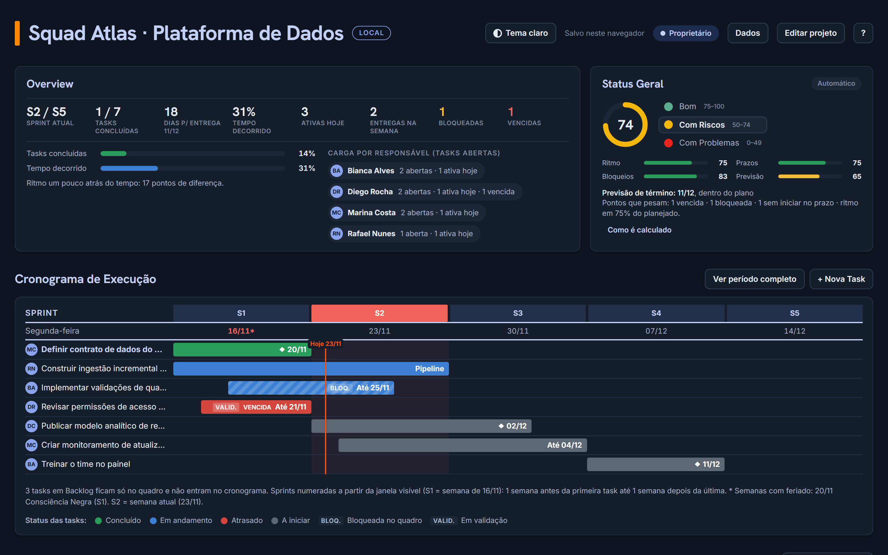

</div>

---

## Sumário

- [O que é](#o-que-é)
- [Instalação em um comando](#instalação-em-um-comando)
- [O que acontece quando você instala](#o-que-acontece-quando-você-instala)
- [Como usar no Claude, no Codex e no navegador](#como-usar)
- [Tour pelas telas](#tour-pelas-telas)
- [Casos de uso](#casos-de-uso)
- [Atalhos de teclado](#atalhos-de-teclado)
- [Regras do quadro e do cronograma](#regras-do-quadro-e-do-cronograma)
- [Status Geral: como a nota é calculada](#status-geral-como-a-nota-é-calculada)
- [Dados, backup e privacidade](#dados-backup-e-privacidade)
- [Permissões no modo compartilhado](#permissões-no-modo-compartilhado)
- [Pedir mudanças na ferramenta](#pedir-mudanças-na-ferramenta)
- [Perguntas frequentes](#perguntas-frequentes)
- [Atualizar e desinstalar](#atualizar-e-desinstalar)
- [Estrutura do repositório](#estrutura-do-repositório)
- [Contribuir](#contribuir) · [Licença](#licença)

## O que é

A Sprint é um painel de acompanhamento de projeto pensado para squads que trabalham em sprints semanais. Em uma única tela, ela junta:

| | |
|---|---|
| 📅 **Cronograma de execução** | Gantt semanal com sprints, linha de *Hoje*, feriados nacionais automáticos, marcos ◆ e barras coloridas por status. |
| 🗂️ **Quadro Kanban** | Backlog → A fazer → Em andamento → Bloqueado → Em validação → Concluído → Histórico, com arrastar e soltar. O cronograma acompanha o quadro. |
| 📊 **Overview** | Sprint atual, tasks concluídas, dias para a entrega, tempo decorrido, tasks ativas, entregas da semana, bloqueadas, vencidas e carga por responsável. |
| ❤️ **Status Geral** | Nota de saúde de 0 a 100 com previsão de término e explicação de cada ponto que pesa. |
| ⚠️ **Pontos de atenção** | Riscos e dependências agrupados por frente, com responsável e prazo. |

É **um arquivo HTML**, sem servidor, sem build e sem bibliotecas externas. A mesma página funciona de dois jeitos:

- **Compartilhado**: publicada como artefato no Claude, guarda as tasks no banco do artefato. Todo mundo com acesso vê as mesmas tasks em tempo real, e as permissões seguem o compartilhamento do Claude.
- **Local**: aberta como arquivo no navegador (é o que o instalador gera e o que o Codex usa). Começa com um projeto de exemplo e salva no próprio navegador.

## Instalação em um comando

**Windows** (PowerShell):

```powershell
irm https://raw.githubusercontent.com/carlos-dataengineer/sprint-gestao-de-tasks/main/install.ps1 | iex
```

**macOS e Linux** (terminal):

```bash
curl -fsSL https://raw.githubusercontent.com/carlos-dataengineer/sprint-gestao-de-tasks/main/install.sh | bash
```

Não precisa de Python, Node nem permissão de administrador. Quer ler antes de rodar? Abra [install.ps1](install.ps1) ou [install.sh](install.sh).

<details>
<summary><b>Outras formas de instalar</b></summary>

**Como plugin do Claude Code**, dentro do Claude Code:

```text
/plugin marketplace add carlos-dataengineer/sprint-gestao-de-tasks
/plugin install sprint@sprint-gestao-de-tasks
```

Nesse caso só a skill é instalada; a ferramenta é gerada na primeira vez que você chamar `/sprint`.

**A partir de um clone:**

```bash
git clone https://github.com/carlos-dataengineer/sprint-gestao-de-tasks.git
cd sprint-gestao-de-tasks
./install.sh            # macOS/Linux
.\install.ps1           # Windows
```

**Opções do instalador:**

| PowerShell | bash | Variável de ambiente | Efeito |
|---|---|---|---|
| `-NoOpen` | `--no-open` | `SPRINT_NO_OPEN=1` | Não abre o navegador no fim |
| `-SkipClaude` | `--skip-claude` | `SPRINT_SKIP_CLAUDE=1` | Não instala a skill no Claude |
| `-SkipCodex` | `--skip-codex` | `SPRINT_SKIP_CODEX=1` | Não instala a skill no Codex |
| `-Ref v2.0.0` | `--ref v2.0.0` | `SPRINT_REF=v2.0.0` | Instala uma versão específica (tag ou branch) |

Com `irm | iex` ou `curl | bash`, use as variáveis de ambiente. Exemplo: `$env:SPRINT_REF='v2.0.0'; irm …/install.ps1 | iex`.

**Sem instalar nada:** baixe `Sprint.html` na [página de releases](https://github.com/carlos-dataengineer/sprint-gestao-de-tasks/releases) e abra no navegador.

</details>

## O que acontece quando você instala

> **A ferramenta é gerada automaticamente na instalação.** Quando o comando termina, a Sprint já está aberta no seu navegador, com um projeto de exemplo, pronta para usar.

```text
  Sprint - Gestao de Tasks
  cronograma de sprints + quadro Kanban + saude do projeto

  > Baixando carlos-dataengineer/sprint-gestao-de-tasks (main)
  ok Skill instalada para Claude em ~/.claude/skills/sprint
  ok Skill instalada para Codex em ~/.codex/skills/sprint
  ok Skill instalada para agentes (pasta compartilhada) em ~/.agents/skills/sprint
  ok Ferramenta gerada em ~/Sprint/Sprint.html
  ok Aberta no navegador

  Pronto. Como usar:
    Navegador  ~/Sprint/Sprint.html  (modo local, ja com um projeto de exemplo)
    Claude     digite /sprint ou peca "abra a Sprint": vira um artefato compartilhado
    Codex      digite $sprint ou peca "abra a Sprint"
```

Passo a passo:

1. **Baixa** o pacote do GitHub (ou usa o clone, se você rodar de dentro dele).
2. **Instala a skill `sprint`** no Claude (`~/.claude/skills`), no Codex (`~/.codex/skills`, ou `$CODEX_HOME`) e na pasta compartilhada de agentes (`~/.agents/skills`).
3. **Gera a ferramenta** em `~/Sprint/Sprint.html` e **abre no navegador**.
4. **Deixa a skill pronta** para o agente: no Claude, `/sprint` publica a Sprint como **artefato compartilhado**; no Codex, `$sprint` abre o arquivo e pode montar o quadro com as suas tasks.

O instalador nunca apaga uma pasta `sprint` que não seja desta skill, remove a versão antiga (`sprint-task-management`) se existir, e pode ser rodado de novo para atualizar.

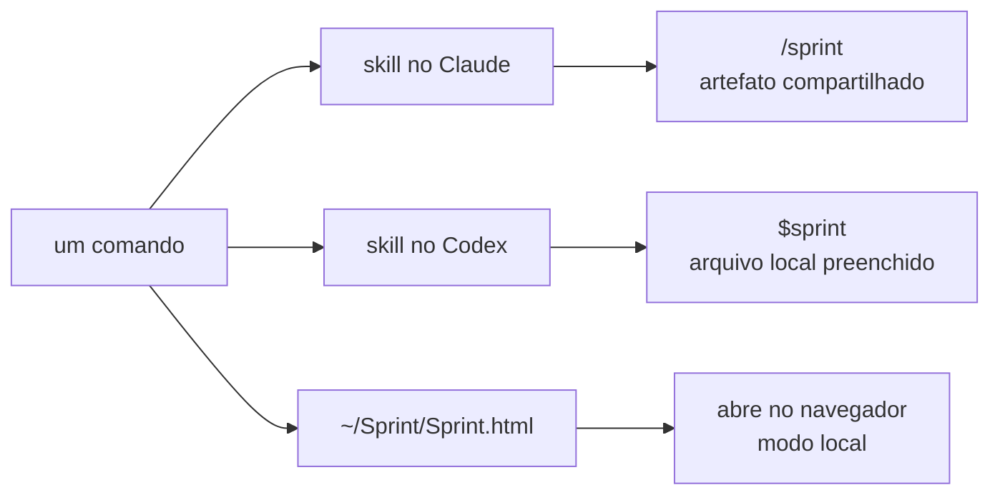

## Como usar

### No Claude (app desktop, Claude Code)

Abra uma conversa nova e digite **`/sprint`**, ou peça em linguagem natural:

> "Abra a Sprint para o projeto *Lançamento do app*, com início na próxima segunda e 6 sprints. Tasks: protótipo das telas (Ana, alta, esta semana), API de cadastro (Bruno, 2 semanas), testes com usuários (Carla, semana 4)."

O Claude publica a Sprint como **artefato** com banco compartilhado, grava o projeto e as tasks que você contou e devolve o link. Compartilhe o artefato com o time: todos veem as mesmas tasks, em tempo real.

Se você já tiver um artefato da Sprint, o Claude oferece abrir o existente em vez de criar outro.

### No Codex

Digite **`$sprint`** (ou escolha *Sprint — Gestão de Tasks* no menu `/skills`) e peça o que precisa:

> "$sprint monte o quadro com as tasks deste arquivo de planejamento."

O Codex copia a ferramenta para `~/Sprint/Sprint.html`, preenche com as suas tasks e abre no navegador.

### Direto no navegador

Abra `~/Sprint/Sprint.html`. Ele começa com o projeto fictício **Squad Atlas** para você explorar. Quando quiser usar de verdade:

- **Dados → Começar do zero** para um painel em branco; ou
- **Editar projeto** para trocar nome, início da S1, número de sprints e feriados, e depois edite ou exclua as tasks de exemplo.

## Tour pelas telas

### Overview e Status Geral

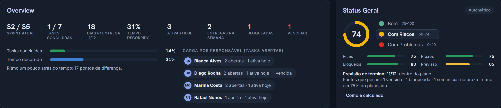

Os oito indicadores do topo seguem o cronograma visível. A barra de *Tasks concluídas* contra *Tempo decorrido* mostra se o time está adiantado ou atrasado, e a carga por responsável mostra quem está com mais tasks abertas, ativas hoje e vencidas. Clicar em **Como é calculado** abre a explicação da nota:

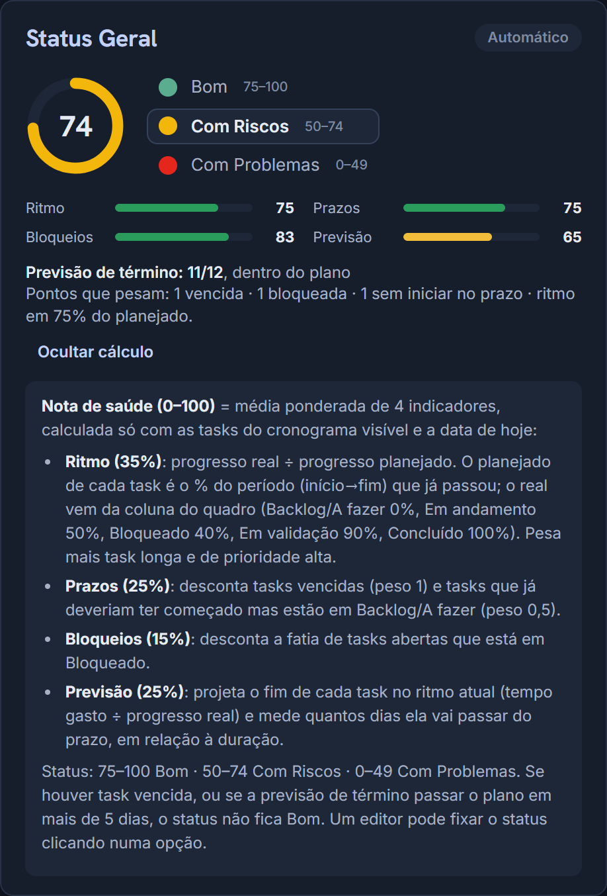

### Cronograma de execução

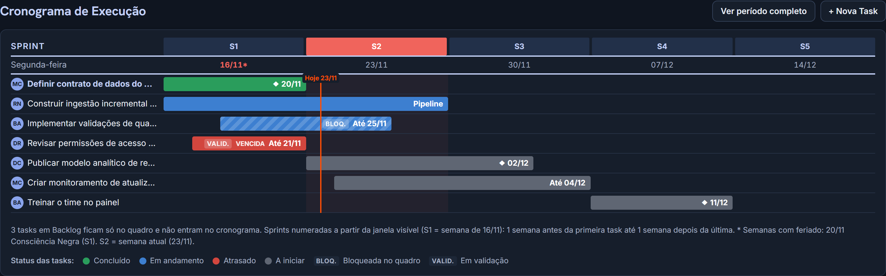

- Uma coluna por semana (sprint), com a segunda-feira de cada uma e `*` nas semanas com feriado.
- A semana atual fica destacada e a linha laranja marca **Hoje**.
- Cores: verde concluído, azul em andamento, vermelho atrasado, cinza a iniciar. Listras indicam task bloqueada no quadro.
- Etiquetas: **BLOQ.**, **VALID.** e **VENCIDA**. ◆ marca entregas importantes.
- A janela é automática (de uma semana antes da primeira task até uma depois da última). **Ver período completo** (`F`) mostra todas as sprints do projeto.
- Passar o mouse num card do quadro acende a linha dele no cronograma. Clicar numa barra abre a task.

### Quadro de tasks

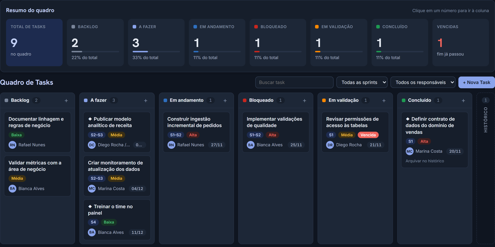

- O **resumo do quadro** em números é clicável: leva até a coluna.
- Busca por texto (`/`), filtro por sprint e por responsável (entende nomes compartilhados como `Ana / Bruno`).
- Cada card mostra sprint, prioridade, responsável, data de fim e, se houver, a imagem de destaque.
- **Arraste** entre colunas para mudar a etapa; a ordem dentro da coluna também é salva.
- Em **Concluído**, *Arquivar no histórico* tira a task do quadro, do cronograma e das métricas. O **Histórico** (`H`) fica recolhido ao lado:

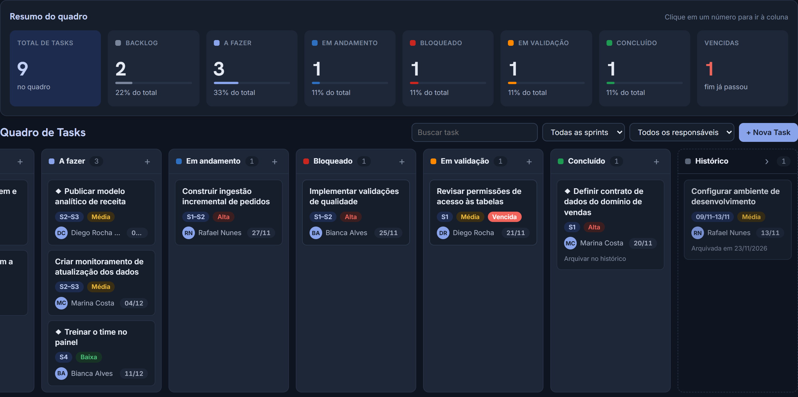

### Editar uma task

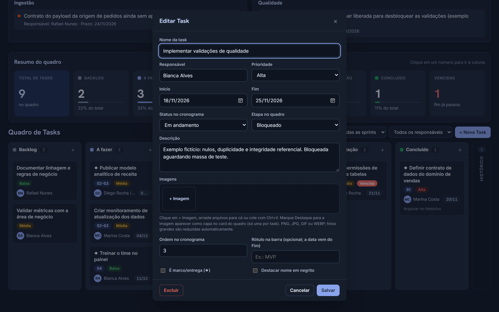

Nome, responsável (com sugestões), prioridade, início e fim, etapa no quadro e status no cronograma (um acompanha o outro), descrição, ordem, rótulo na barra, marco e destaque. **Imagens**: anexe pelo botão, arrastando ou colando com `Ctrl+V`; fotos grandes são reduzidas e uma delas pode virar capa do card.

### Pontos de atenção

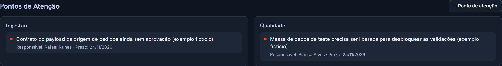

Riscos, dependências e pendências agrupados por frente, com responsável e prazo. `P` cria um novo.

### Projeto, dados e atalhos

<p>
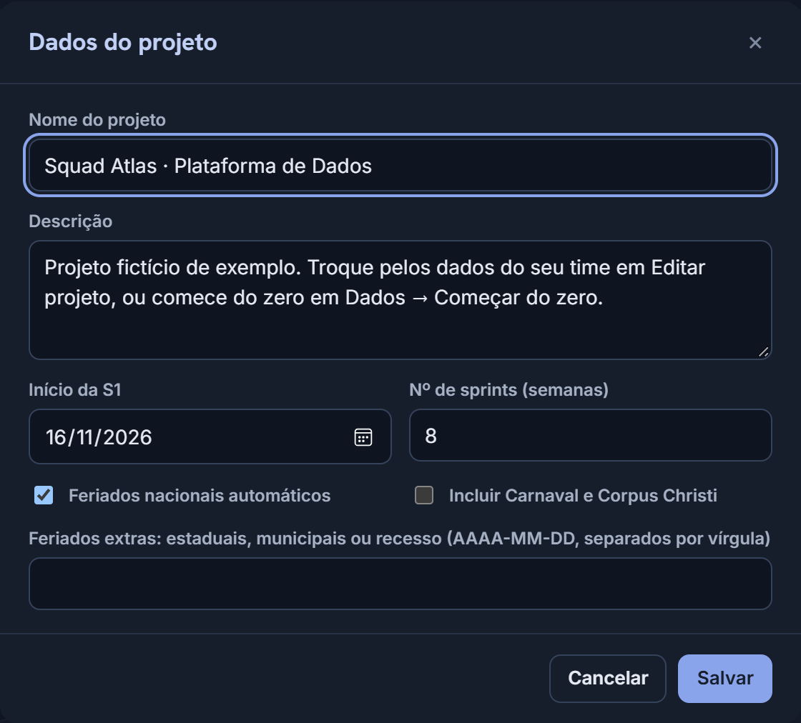
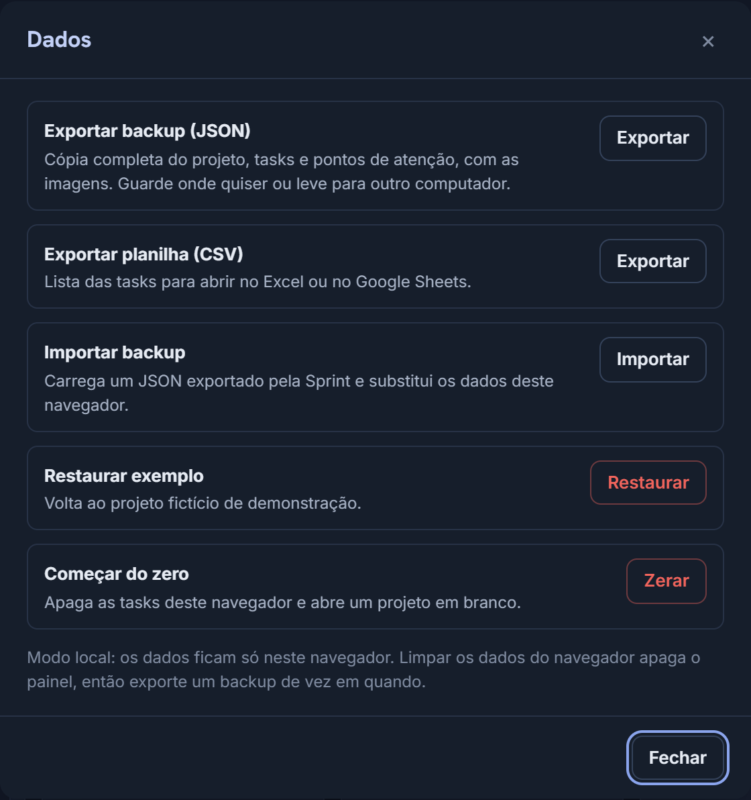
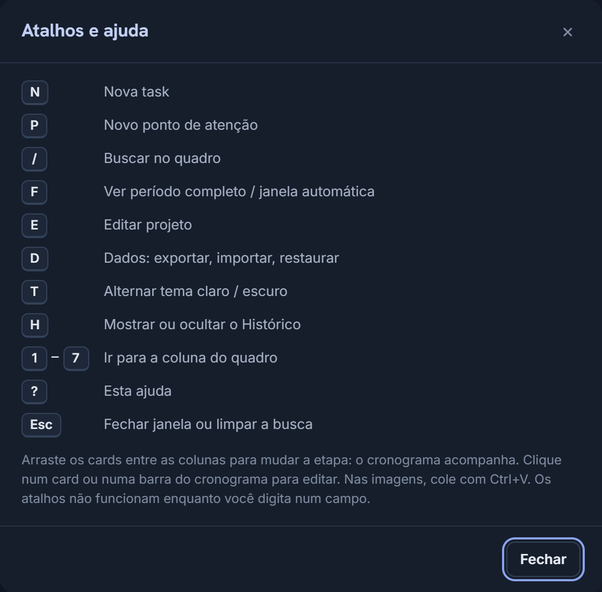
</p>

**Editar projeto** (`E`) define nome, descrição, início da S1, número de sprints e feriados (nacionais automáticos, Carnaval e Corpus Christi opcionais, mais extras estaduais ou municipais). **Dados** (`D`) exporta e importa. **?** mostra os atalhos.

### Tema claro e celular

<p>
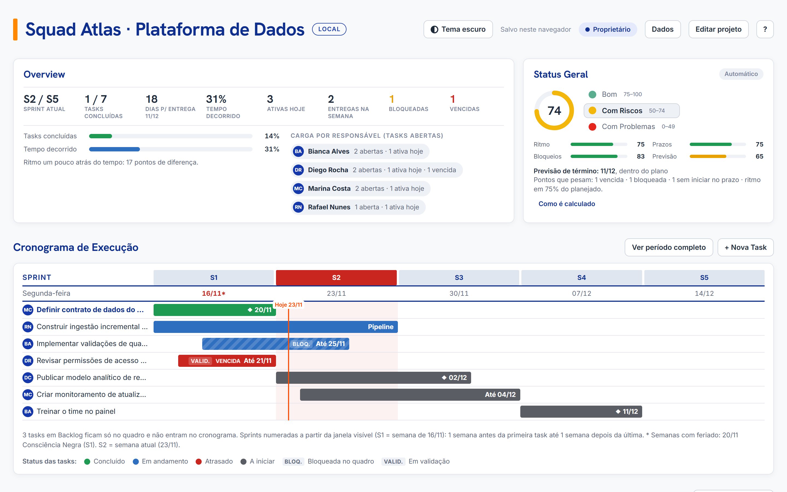
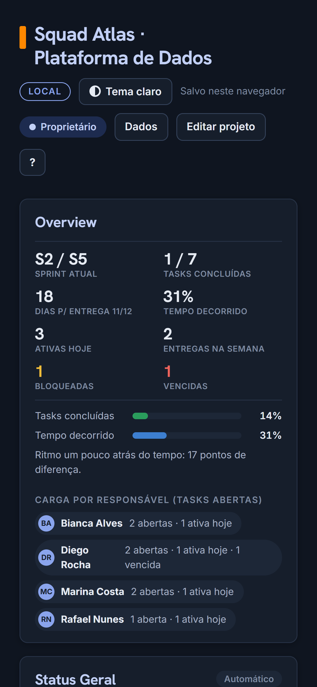
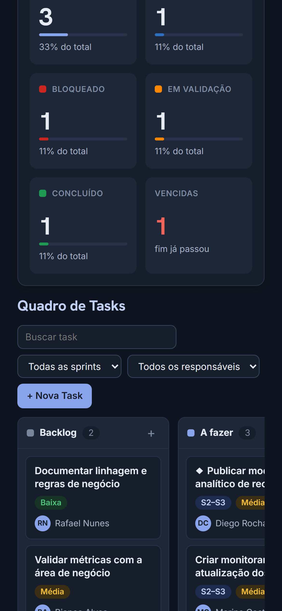
</p>

Abre no tema escuro; `T` alterna para o claro. O layout se ajusta a tablets e celulares.

## Casos de uso

| Situação | Como a Sprint ajuda |
|---|---|
| **Daily do squad** | Abra o quadro, filtre por responsável e passe coluna por coluna. Bloqueadas e vencidas aparecem em vermelho no resumo. |
| **Status semanal para gestão** | Overview e Status Geral dão o resumo em um print. A nota explica o que pesa (vencidas, bloqueios, ritmo). Exporte o CSV se precisar de planilha. |
| **Planejamento de sprints** | Coloque as ideias no Backlog sem data; ao dar início e fim, a task entra no cronograma na sprint certa, já descontando feriados. |
| **Projeto de dados ou de TI com várias frentes** | Pontos de atenção por frente (ingestão, qualidade, infraestrutura), marcos ◆ nas entregas e o histórico guardando o que já foi entregue. |
| **Consultoria ou projeto com cliente** | Publique como artefato e compartilhe com o cliente como Visualizador: ele acompanha sem poder alterar. |
| **Organização pessoal** | Use no modo local, só no seu navegador, e exporte um backup de vez em quando. |
| **Transformar uma lista em quadro** | Cole a lista de tarefas na conversa e peça `/sprint` (Claude) ou `$sprint` (Codex): o agente monta o quadro e o cronograma. |

## Atalhos de teclado

| Tecla | Ação |
|---|---|
| `N` | Nova task |
| `P` | Novo ponto de atenção |
| `/` | Buscar no quadro |
| `F` | Ver período completo / voltar à janela automática |
| `E` | Editar projeto |
| `D` | Dados: exportar, importar, restaurar |
| `T` | Alternar tema claro / escuro |
| `H` | Mostrar ou ocultar o Histórico |
| `1` a `7` | Ir para a coluna do quadro (Backlog … Histórico) |
| `?` | Abrir a ajuda de atalhos |
| `Esc` | Fechar janela ou limpar a busca |
| `Enter` / `Espaço` | Abrir o card em foco |
| `Ctrl+V` | Colar imagem na janela da task |

Os atalhos não funcionam enquanto você digita num campo. Criar e editar exigem permissão de edição.

## Regras do quadro e do cronograma

| Coluna do quadro | Status no cronograma | Entra no cronograma e nas métricas? |
|---|---|---|
| Backlog | A iniciar | ❌ (datas opcionais) |
| A fazer | A iniciar | ✅ |
| Em andamento | Em andamento | ✅ |
| Bloqueado | Em andamento (listrado, BLOQ.) | ✅ |
| Em validação | Em andamento (VALID.) | ✅ |
| Concluído | Concluído | ✅ |
| Histórico | Concluído | ❌ (arquivada) |

- A barra termina sempre na data de **Fim** da task.
- Task não concluída com o fim no passado vira **Atrasado** (vermelho) e conta como **vencida**.
- Para sair do Backlog, a task precisa de início e fim.
- Só tasks em Concluído vão para o Histórico.
- A semana útil é de segunda a sexta.

## Status Geral: como a nota é calculada

A nota (0–100) é a média ponderada de quatro indicadores, calculada com as tasks do cronograma visível e a data de hoje:

| Indicador | Peso | O que mede |
|---|---|---|
| **Ritmo** | 35% | Progresso real ÷ progresso planejado. O planejado é o % do período da task que já passou; o real vem da coluna (Backlog/A fazer 0%, Em andamento 50%, Bloqueado 40%, Em validação 90%, Concluído 100%). Tasks longas e de prioridade alta pesam mais. |
| **Prazos** | 25% | Desconta tasks vencidas (peso 1) e tasks que já deviam ter começado mas estão em Backlog/A fazer (peso 0,5). |
| **Bloqueios** | 15% | Desconta a fatia das tasks abertas que está em Bloqueado. |
| **Previsão** | 25% | Projeta o fim de cada task no ritmo atual e mede quantos dias vai passar do prazo. |

**75–100 Bom · 50–74 Com Riscos · 0–49 Com Problemas.** O status não fica *Bom* se houver task vencida ou se a previsão de término passar o plano em mais de 5 dias. Quem tem edição completa pode fixar o status manualmente e depois voltar ao automático.

## Dados, backup e privacidade

| | Modo local | Modo compartilhado |
|---|---|---|
| Onde fica | `localStorage` do navegador | Banco do artefato no Claude |
| Quem vê | Só quem usa aquele navegador | Quem tem acesso ao artefato |
| Tempo real entre pessoas | ❌ | ✅ |
| Exportar backup (JSON) e planilha (CSV) | ✅ | ✅ |
| Importar backup, restaurar exemplo, começar do zero | ✅ | ❌ (peça ao Claude para importar) |

- Nada é enviado para servidores no modo local. A página só carrega as fontes do Google Fonts (sem internet, usa as do sistema).
- Limpar os dados do navegador apaga o painel local: **exporte um backup de tempos em tempos**.
- Não guarde senhas, tokens ou dados sensíveis nas tasks.
- Para levar um painel local para o Claude: exporte o JSON e peça "publique a Sprint e importe este backup".

Formato completo em [docs/DADOS.md](docs/DADOS.md).

## Permissões no modo compartilhado

| Nível no compartilhamento do Claude | Pode |
|---|---|
| **Proprietário** e **Editor** | Tudo, inclusive a estrutura: nome, início, sprints, feriados e fixar o status. |
| **Contribuidor** | Criar, editar, mover e arquivar tasks e pontos de atenção; anexar imagens. |
| **Comentarista** e **Visualizador** | Só ver. |

O selo no topo mostra o seu nível (*Proprietário*, *Edição completa*, *Edição de tasks* ou *Somente leitura*). Editor também pode publicar novas versões da página; para quem só usa as tasks, prefira Contribuidor. Detalhes em [skills/sprint/references/CAPACIDADES.md](skills/sprint/references/CAPACIDADES.md).

## Pedir mudanças na ferramenta

A skill também evolui a ferramenta. Peça na conversa:

> "Na Sprint, adicione um filtro por prioridade no quadro."
> "Troque a cor da coluna Em validação para roxo."

O agente altera o código da skill, testa e entrega a nova versão (republica o artefato ou atualiza o arquivo). Para a mudança valer para todo mundo, [contribua com um pull request](CONTRIBUTING.md).

## Perguntas frequentes

<details>
<summary><b>Instalei, mas o Claude ou o Codex não reconhece <code>/sprint</code>.</b></summary>

Abra uma **conversa nova** depois de instalar. Confira se existe `~/.claude/skills/sprint/SKILL.md` (Claude) ou `~/.codex/skills/sprint/SKILL.md` (Codex). Se usa `CODEX_HOME`, rode o instalador com a variável definida.
</details>

<details>
<summary><b>O artefato abriu dizendo que as alterações ficam só neste navegador.</b></summary>

O artefato foi publicado sem o banco compartilhado. Peça ao Claude: "republique a Sprint com as capacidades db, user, assets e downloads". As capacidades estão em [CAPACIDADES.md](skills/sprint/references/CAPACIDADES.md).
</details>

<details>
<summary><b>Rodei o instalador de novo. Perdi minhas tasks?</b></summary>

Não. No modo local as tasks ficam no navegador, não no arquivo `Sprint.html`. No modo compartilhado ficam no banco do artefato.
</details>

<details>
<summary><b>Dá para usar em equipe sem o Claude?</b></summary>

No modo local cada navegador tem os próprios dados. Para trabalho em equipe em tempo real, use o artefato no Claude. Sem ele, dá para trocar o backup JSON entre as pessoas.
</details>

<details>
<summary><b>As datas do exemplo mudam a cada dia.</b></summary>

O exemplo é montado relativo à data de hoje, para sempre ter tasks concluídas, em andamento, vencidas e futuras. Use **Dados → Começar do zero** para o seu projeto.
</details>

<details>
<summary><b>Os feriados do meu estado não aparecem.</b></summary>

Os nacionais são automáticos. Adicione estaduais, municipais ou recessos em **Editar projeto → Feriados extras** (AAAA-MM-DD, separados por vírgula).
</details>

<details>
<summary><b>O PowerShell bloqueou o script.</b></summary>

O comando `irm … | iex` não depende da política de execução. Se rodar o arquivo baixado, use `powershell -ExecutionPolicy Bypass -File .\install.ps1`.
</details>

## Atualizar e desinstalar

**Atualizar:** rode o comando de instalação de novo.

**Desinstalar** (remove a skill; mantém `~/Sprint/Sprint.html`, a não ser com `-All`/`--all`):

```powershell
irm https://raw.githubusercontent.com/carlos-dataengineer/sprint-gestao-de-tasks/main/uninstall.ps1 | iex
```

```bash
curl -fsSL https://raw.githubusercontent.com/carlos-dataengineer/sprint-gestao-de-tasks/main/uninstall.sh | bash
```

Tasks salvas no navegador e artefatos publicados no Claude não são apagados.

## Estrutura do repositório

```text
.
├── src/sprint.html                 # fonte única da ferramenta (edite aqui)
├── app/index.html                  # gerado: demo para abrir no navegador
├── skills/sprint/                  # a skill instalada no Claude e no Codex
│   ├── SKILL.md                    # como o agente entrega, preenche e evolui a Sprint
│   ├── agents/openai.yaml          # nome e prompt padrão no Codex
│   ├── assets/sprint.html          # gerado: documento completo (modo local)
│   ├── assets/sprint-artifact.html # gerado: fragmento para artefato do Claude
│   └── references/                 # capacidades, formato de dados, como evoluir
├── .claude-plugin/                 # plugin e marketplace do Claude Code
├── install.ps1 · install.sh        # instalação em um comando
├── uninstall.ps1 · uninstall.sh
├── scripts/build.py                # gera app/ e assets/ a partir de src/
├── scripts/screenshots.py          # gera as imagens deste README
├── tests/                          # validação estática e teste no navegador
├── docs/                           # arquitetura, dados, desenvolvimento, imagens
└── .github/                        # CI, release, modelos de issue e PR
```

Mais detalhes: [docs/ARQUITETURA.md](docs/ARQUITETURA.md) · [docs/DESENVOLVIMENTO.md](docs/DESENVOLVIMENTO.md)

## Contribuir

Sugestões e correções são bem-vindas. Leia o [guia de contribuição](CONTRIBUTING.md) e o [código de conduta](CODE_OF_CONDUCT.md). Para dúvidas, veja o [suporte](SUPPORT.md); para falhas de segurança, a [política de segurança](SECURITY.md). O histórico de versões está no [CHANGELOG](CHANGELOG.md).

## Licença

[MIT](LICENSE) © Krlos Robertt. Use, adapte e distribua à vontade, mantendo o aviso de licença.
