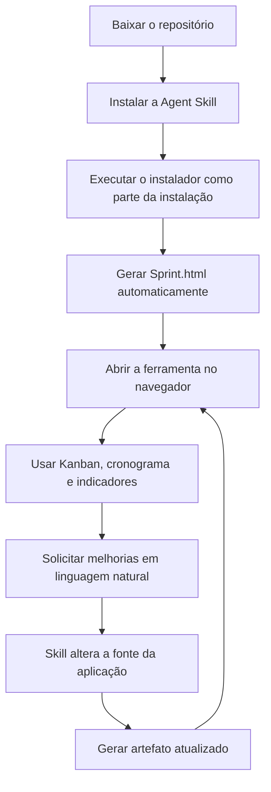
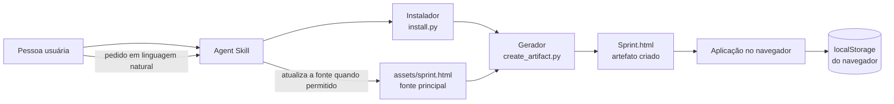

# Sprint — Gestão de Tasks

[](https://github.com/carlos-dataengineer/sprint-gestao-de-tasks/actions/workflows/quality.yml)
[](LICENSE)

**A Sprint é uma ferramenta que eu criei para organizar tarefas, acompanhar entregas e entender como um projeto está avançando.** Ela reúne um quadro Kanban, um cronograma por sprint e indicadores em uma única tela.

O projeto é distribuído com uma **Agent Skill**. A instalação da Skill inclui a criação do artefato: o procedimento de instalação executa o instalador e gera o arquivo `Sprint.html`. Assim, qualquer pessoa que baixar o projeto e concluir a instalação recebe a ferramenta pronta para abrir no navegador, sem precisar montar o HTML manualmente.

Depois da criação, a própria Skill também orienta a evolução da ferramenta. A pessoa pode pedir mudanças em linguagem natural, e o agente compatível altera o código-fonte e gera uma nova versão do artefato. Quando o ambiente permite gravar os arquivos da Skill, a fonte também fica atualizada para as próximas utilizações.

A demonstração vem com dados fictícios. Não há informações reais de clientes, projetos ou pessoas.

## Como funciona para quem baixa



## Instalação

A pasta `sprint-skill` contém a Skill completa. Em um ambiente com suporte a Agent Skills:

1. Baixe ou clone este repositório.
2. Instale a pasta `sprint-skill` no local de Skills reconhecido pelo seu agente.
3. Como parte da instalação, execute o bootstrap:

   ```bash
   python sprint-skill/scripts/install.py
   ```

4. O instalador cria `Sprint.html` na pasta de trabalho atual. Para escolher outro destino:

   ```bash
   python sprint-skill/scripts/install.py --output ./minha-pasta/Sprint.html
   ```

5. Ative a Skill no agente compatível para pedir personalizações e melhorias.

**A instalação só está concluída depois que o instalador confirmar a criação do `Sprint.html`.** Se a plataforma de agente tiver um fluxo próprio, configure-o para executar esse passo automaticamente. Se ela apenas copiar a pasta da Skill, execute o comando ao finalizar a instalação. O bootstrap está incluído para que o mesmo procedimento funcione para qualquer pessoa que baixar o projeto.

## Arquitetura



A Skill orienta a instalação, criação e evolução da ferramenta. O instalador e o gerador preparam o HTML. A aplicação é o artefato que a pessoa usa no dia a dia.

## O que a Sprint faz

| Área | O que dá para acompanhar |
|---|---|
| Visão geral | Sprint atual, tarefas concluídas, tempo decorrido, tarefas ativas, bloqueios e atrasos |
| Kanban | Backlog, A fazer, Em andamento, Bloqueado, Em validação, Concluído e Histórico |
| Cronograma | Planejamento semanal no estilo Gantt, marcos e datas |
| Planejamento | Tarefas por período, responsável e prioridade |
| Execução | Criação e edição de tarefas, descrições, responsáveis, imagens e movimentação entre etapas |
| Saúde do projeto | Ritmo, prazos, bloqueios e previsão de conclusão |
| Pontos de atenção | Riscos, dependências e assuntos que precisam de acompanhamento |

## Evoluir a ferramenta com a Skill

A Skill não serve apenas para criar a primeira versão. A pessoa pode pedir, por exemplo, “adicione um filtro por responsável” ou “crie uma visão de entregas por semana”. A Skill analisa o pedido, altera `assets/sprint.html`, valida a mudança e gera outro `Sprint.html`.

Quando o ambiente permite salvar a pasta da Skill, a fonte fica atualizada para as próximas utilizações. Se não permitir escrita, o agente entrega o novo artefato, mas a fonte instalada precisa ser substituída para preservar a melhoria. Uma nova geração não altera cópias já abertas no navegador.

## Testar sem instalar

O repositório inclui uma demonstração pronta em [Sprint.html](Sprint.html). Basta abrir o arquivo em um navegador moderno.

Para gerar uma cópia manualmente:

```bash
python sprint-skill/scripts/create_artifact.py --output ./Sprint.html
```

## Dados e privacidade

A aplicação é um HTML independente. Os dados de uso ficam no `localStorage` do navegador atual. Esta versão não oferece banco de dados remoto, autenticação ou sincronização entre pessoas e dispositivos. Os dados iniciais são fictícios; não use esta versão para guardar credenciais ou informações confidenciais.

## Estrutura do projeto

```text
.
├── README.md
├── Sprint.html
├── LICENSE
├── .github/workflows/
└── sprint-skill/
    ├── SKILL.md
    ├── assets/sprint.html
    ├── scripts/install.py
    ├── scripts/create_artifact.py
    ├── docs/
    └── tests/
```

## Licença

Este projeto usa a [MIT License](LICENSE). Você pode usar, estudar, modificar e distribuir o código respeitando seus termos.

## Sobre o projeto

Este é um projeto independente que estou desenvolvendo e melhorando aos poucos. Quero manter a ferramenta simples de usar, fácil de instalar e aberta a adaptações. Sugestões e contribuições são bem-vindas.
