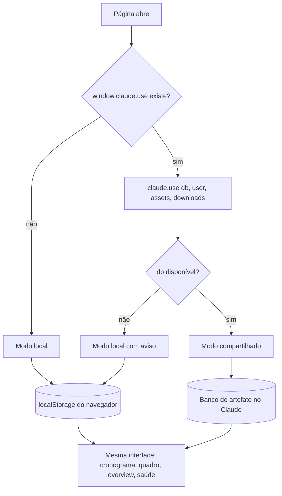
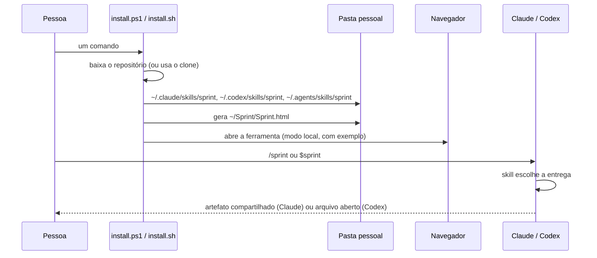

# Arquitetura

A Sprint é **uma página HTML única** (HTML, CSS e JavaScript puros, sem build e sem bibliotecas). O mesmo código roda em dois modos, decididos na abertura.

## Camada de dados

As telas falam com um objeto `S.db` que tem sempre a mesma forma (`doc(path)`, `collection(name)`, `onSnapshot`, `add`, `set`, `update`, `delete`):

- **Compartilhado:** `S.db` é o banco do artefato (`claude.use("db")`). Permissões vêm de `claude.use("user")` e as imagens de `claude.use("assets")`.
- **Local:** `S.db` é uma implementação em memória com o mesmo contrato, gravada no `localStorage` (chave `sprint.v2`). Imagens viram data URLs no próprio armazenamento.

Assim, cronograma, quadro, overview e saúde não sabem em que modo estão.

## Fluxo de instalação

## Peças

| Peça | Papel |
|---|---|
| `src/sprint.html` | Fonte única. |
| `scripts/build.py` | Gera o documento completo (`app/index.html`, `skills/sprint/assets/sprint.html`) e o fragmento para artefato (`sprint-artifact.html`). |
| `skills/sprint/SKILL.md` | Ensina o agente a entregar a ferramenta em cada ambiente, preencher dados e evoluir o código. |
| `skills/sprint/agents/openai.yaml` | Nome, descrição e prompt padrão no Codex. |
| `.claude-plugin/` | Permite instalar como plugin do Claude Code. |
| `install.*` / `uninstall.*` | Instalação em um comando, sem Python e sem administrador. |

## Cálculos principais

- **Janela do cronograma:** de 1 semana antes da primeira task até 1 semana depois da última; as sprints são numeradas a partir da janela (S1, S2…). "Ver período completo" usa o início e o nº de sprints do projeto.
- **Semana útil:** segunda a sexta; barras começam e terminam na fração do dia.
- **Feriados:** nacionais do Brasil calculados para qualquer ano (fixos + Páscoa → Sexta-feira Santa; opcionalmente Carnaval e Corpus Christi), mais extras.
- **Nota de saúde:** média ponderada de Ritmo (35%), Prazos (25%), Bloqueios (15%) e Previsão (25%). 75–100 Bom, 50–74 Com Riscos, 0–49 Com Problemas. Não fica Bom com task vencida ou previsão mais de 5 dias além do plano.
