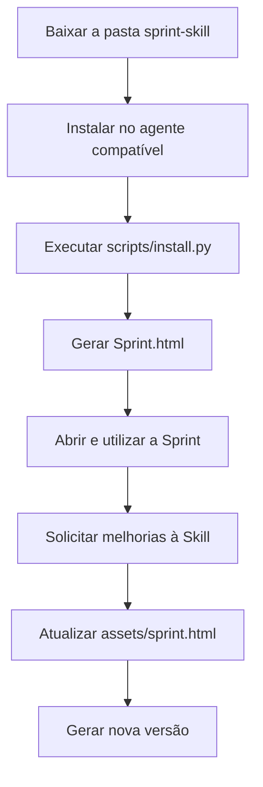

# Sprint — Gestão de Tasks (Agent Skill)

Esta pasta contém a Skill e os arquivos necessários para criar e evoluir a ferramenta Sprint.

## O que acontece quando alguém instala

A instalação da Skill inclui a geração do artefato HTML. O procedimento de instalação executa `scripts/install.py`, que chama o gerador e cria `Sprint.html` na pasta de trabalho atual. Esse passo faz parte da instalação para que qualquer pessoa que baixar e instalar o pacote receba a ferramenta pronta para abrir.



Conclua a instalação executando:

```bash
python scripts/install.py
```

Para escolher o destino do arquivo:

```bash
python scripts/install.py --output /caminho/Sprint.html
```

Se a plataforma de agente tiver um instalador próprio, configure-o para executar esse bootstrap automaticamente. Se ela apenas copiar a pasta, execute o comando ao finalizar a instalação. A instalação só está concluída depois de o script confirmar que o arquivo foi criado.

## Como a Skill evolui a aplicação

O arquivo `assets/sprint.html` é a fonte principal. Quando alguém pede uma melhoria em linguagem natural, a Skill deve:

1. Entender o resultado esperado e revisar a implementação atual.
2. Alterar `assets/sprint.html`, preservando os recursos que não fazem parte do pedido.
3. Atualizar documentação e testes quando a mudança exigir.
4. Gerar outra versão com `scripts/create_artifact.py`.
5. Validar o arquivo e entregar a nova versão.

Quando o ambiente permite escrita na pasta da Skill, a fonte principal permanece atualizada para as próximas utilizações. Se a pasta for somente leitura, a Skill deve informar que entregou o novo artefato, mas que a fonte do pacote precisa ser substituída para preservar a melhoria.

## Estrutura

- `SKILL.md`: instruções que orientam o agente.
- `assets/sprint.html`: código-fonte principal da aplicação.
- `scripts/install.py`: bootstrap da instalação; gera o artefato.
- `scripts/create_artifact.py`: gera o HTML a partir da fonte principal.
- `docs/`: documentação da arquitetura, recursos e dados.
- `tests/`: verificações automatizadas do pacote.

## Limites da versão atual

A Sprint é um HTML independente. Os dados de uso ficam no `localStorage` do navegador atual. Não há backend, login, sincronização entre dispositivos ou colaboração multiusuário nesta versão. A demonstração usa dados fictícios.
