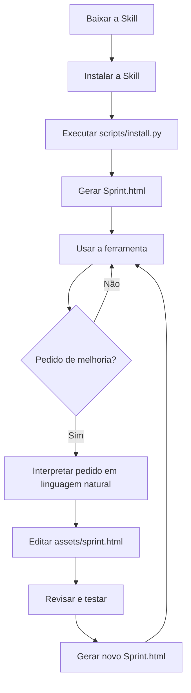

# Sprint — Gestão de Tasks

Esta Skill instala, cria e evolui a Sprint. **A instalação da Skill inclui a criação do artefato `Sprint.html`.** Não considere a instalação concluída antes de executar o bootstrap e confirmar que o arquivo foi criado.

## Instalação: criar o artefato automaticamente

Durante o procedimento de instalação desta Skill, execute o instalador:

```bash
python scripts/install.py
```

O script cria `Sprint.html` na pasta de trabalho atual. Se a pessoa indicar outro destino:

```bash
python scripts/install.py --output /caminho/Sprint.html
```

Se o ambiente de instalação reconhece scripts de bootstrap, conecte essa etapa ao processo de instalação para que seja executada automaticamente. Se o ambiente apenas copiar a pasta da Skill, execute o comando assim que a cópia terminar. A instalação só está completa quando o instalador informar o caminho do artefato gerado.

Depois de instalar, ative esta Skill normalmente para utilizar a ferramenta e pedir personalizações.

## Como a Skill trabalha

O arquivo `assets/sprint.html` é a fonte principal. `scripts/install.py` executa o gerador no momento da instalação. `scripts/create_artifact.py` copia a fonte e cria uma versão pronta para abrir no navegador.



## Criar novamente a ferramenta

Se o artefato for removido ou a pessoa pedir uma nova cópia, execute:

```bash
python scripts/create_artifact.py
```

O arquivo será criado como `Sprint.html` na pasta atual. Para outro destino:

```bash
python scripts/create_artifact.py --output /caminho/Sprint.html
```

Confira se o arquivo existe e não está vazio. Se Python não estiver disponível, copie `assets/sprint.html` para o destino solicitado usando os recursos de arquivo disponíveis.

## Evoluir a ferramenta durante o uso

Quando a pessoa pedir uma melhoria, trate o pedido como uma alteração no produto, não apenas como sugestão.

1. Entenda o resultado esperado e verifique como o recurso atual foi implementado.
2. Altere o código principal `assets/sprint.html`, preservando o que já funciona, a menos que a pessoa peça uma mudança maior.
3. Revise as regras, os dados, a documentação e os testes que possam ser afetados.
4. Gere novamente `Sprint.html` com `scripts/create_artifact.py`.
5. Faça as verificações de qualidade e teste o fluxo alterado sempre que o ambiente permitir.
6. Entregue a nova versão e explique o que mudou.

### Manter a Skill atualizada

- Sempre que a pasta da Skill estiver disponível para edição, atualize `assets/sprint.html` com a versão mais recente antes de gerar o artefato. Essa é a fonte usada nas próximas execuções.
- Se a alteração mudar o comportamento da ferramenta, atualize também `SKILL.md`, os documentos relacionados e os testes, quando necessário.
- Se a pasta da Skill estiver em local somente de leitura ou não puder ser salva, não diga que a Skill foi atualizada permanentemente. Entregue o HTML atualizado e informe que a fonte do pacote precisa ser substituída para preservar a melhoria nas próximas instalações.
- A geração de uma nova cópia não atualiza arquivos já gerados, cópias abertas no navegador ou outras instalações da Skill. Oriente a pessoa a abrir ou recarregar o novo artefato.
- Não descarte melhorias anteriores. Comece sempre pela versão mais recente da fonte principal disponível.

## Regras do produto

- A Sprint reúne Kanban, cronograma semanal, visão geral, indicadores, responsáveis, pontos de atenção e histórico.
- O artefato é um HTML independente, sem necessidade de servidor ou etapa de compilação.
- A primeira abertura usa apenas dados fictícios: projeto, pessoas, tarefas, bloqueios e datas de demonstração.
- As alterações feitas na ferramenta ficam no armazenamento local (`localStorage`) do navegador. Não existe sincronização entre usuários ou dispositivos nesta versão.
- A pessoa pode substituir os exemplos pelos próprios dados. Avise que os dados locais podem ser perdidos se o armazenamento do navegador for apagado.
- Nunca recupere ou inclua dados reais do ambiente de origem, nomes de clientes, credenciais, chaves de API, registros privados ou identificadores proprietários.
- Não apresente backend, login, permissões, sincronização ou backup como recursos existentes.

## Verificação antes de concluir a instalação ou entregar atualização

- O bootstrap/gerador foi executado sem erro.
- O arquivo `Sprint.html` existe e não está vazio.
- O título e o nome visível são “Sprint — Gestão de Tasks”.
- A aplicação continua independente e não depende de SDK proprietário.
- Os dados de demonstração continuam claramente fictícios.
- As mudanças solicitadas aparecem no artefato gerado.
- Se a fonte da Skill não pôde ser atualizada, isso foi informado com clareza.
