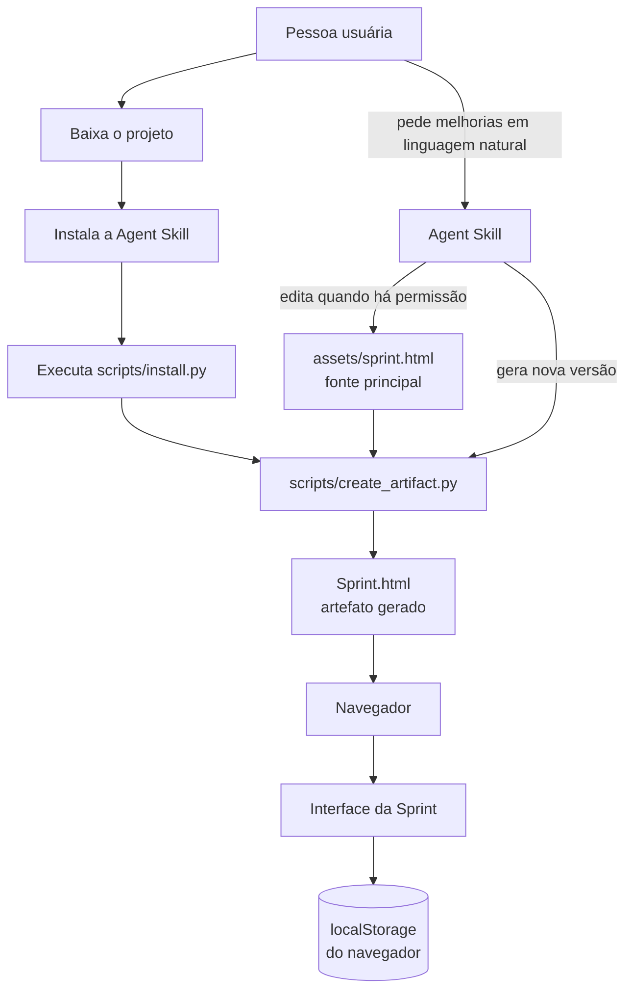
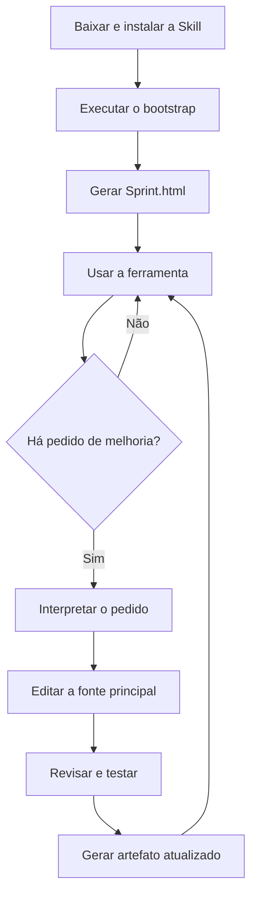

# Como a Sprint é organizada

## Visão geral

A Sprint tem duas partes principais:

- **A Skill:** orienta a instalação, cria a ferramenta e aplica as melhorias solicitadas.
- **A aplicação:** é o arquivo HTML que abre no navegador e reúne os recursos de gestão de tarefas.

Durante a instalação, o bootstrap `scripts/install.py` executa o gerador e cria o artefato `Sprint.html`. O procedimento de instalação só termina depois que o arquivo é criado e verificado.

## Arquitetura

## Ciclo de criação e melhoria

A Skill pode trabalhar em linguagem natural: a pessoa descreve o que quer mudar e a Skill transforma o pedido em alterações no código. Quando o ambiente permite salvar a pasta da Skill, a fonte principal fica atualizada para as próximas execuções. Se não houver permissão de escrita, a Skill ainda pode entregar o HTML modificado, mas a fonte do pacote precisará ser atualizada depois.

A geração do arquivo não altera automaticamente uma cópia que já esteja aberta no navegador, nem sincroniza outras instalações. Para usar uma melhoria, abra ou recarregue a nova versão do artefato.

## Como a aplicação funciona

A aplicação é client-side e está concentrada em um único HTML. O arquivo reúne estrutura da página, estilos e JavaScript. Não há etapa de compilação, servidor ou biblioteca JavaScript obrigatória.

### Partes internas

1. **Interface:** telas, cartões, quadro Kanban, cronograma, filtros, modais e temas claro/escuro.
2. **Regras da aplicação:** movimentação das tarefas, datas, sprints, feriados, indicadores de saúde e previsão.
3. **Dados locais:** leitura e gravação no `localStorage` do navegador.
4. **Imagens:** anexos convertidos em Data URL e guardados no armazenamento local.
5. **Geração:** Skill e scripts que produzem uma cópia HTML pronta para abrir.

## Inicialização e dados

- Ao abrir, a aplicação procura os dados salvos no navegador usando a chave `sprint.demo.v1`.
- Se ainda não houver dados válidos, carrega o conjunto fictício `DEMO`.
- A interface apresenta as informações e acompanha as alterações feitas durante o uso.
- As mudanças são salvas no navegador atual.

## O que esta versão não faz

- Não tem backend nem banco de dados remoto.
- Não sincroniza alterações entre pessoas, computadores ou navegadores.
- Não possui login, perfis ou controle de acesso.
- Não oferece backup automático nem recuperação de dados apagados.
- Não atualiza sozinha uma cópia antiga do HTML já aberta ou distribuída.

O `localStorage` é vinculado ao navegador e ao perfil em que a aplicação foi usada. Por isso, não deve ser tratado como armazenamento seguro para senhas, tokens ou informações confidenciais.
