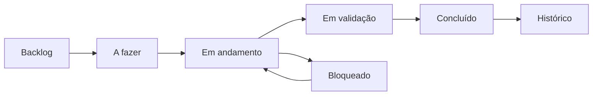

# O que a Sprint faz

Este documento explica os recursos que fazem parte da aplicação.

## Recursos disponíveis

| Área | Como funciona | Situação |
|---|---|---|
| Visão geral | Mostra sprint atual, conclusão, tempo, tarefas ativas, bloqueios e atrasos | Disponível |
| Progresso | Compara o andamento das tarefas com o tempo planejado | Disponível |
| Carga por responsável | Mostra tarefas abertas atribuídas a cada pessoa | Disponível |
| Saúde do projeto | Calcula uma indicação de ritmo, prazos, bloqueios e previsão | Disponível |
| Cronograma | Exibe as tarefas em uma linha do tempo semanal no estilo Gantt | Disponível |
| Calendário | Considera feriados nacionais e datas extras configuradas | Disponível |
| Pontos de atenção | Agrupa riscos, dependências e assuntos que precisam de acompanhamento | Disponível |
| Kanban | Organiza tarefas em sete etapas, do Backlog ao Histórico | Disponível |
| Tarefas | Permite criar, editar, excluir, priorizar e atribuir responsáveis | Disponível |
| Arrastar e soltar | Permite mover tarefas entre colunas e mudar sua ordem | Disponível |
| Filtros | Ajuda a localizar tarefas por texto, sprint e responsável | Disponível |
| Imagens | Permite anexar, destacar e visualizar imagens | Disponível, com armazenamento local |
| Tema | Permite alternar entre tema claro e escuro | Disponível |
| Salvamento | Guarda as alterações no navegador atual | Disponível |
| Colaboração online | Compartilha o mesmo projeto entre pessoas em tempo real | Não disponível |
| Login e permissões | Identifica usuários e controla o que cada um pode fazer | Não disponível |
| Backup e restauração | Exporta e importa dados do projeto | Ideia para versão futura |

## Fluxo das tarefas

O fluxo representa o caminho mais comum. Não é obrigatório que toda tarefa passe por todas as etapas.

## Regras importantes

- As tarefas no Backlog aparecem no quadro, mas não entram no cronograma nem nos indicadores de saúde.
- Para mover uma tarefa para fora do Backlog, é necessário informar as datas de início e fim.
- A data final não pode ser anterior à data inicial.
- Quando uma tarefa muda de coluna, seu status também é atualizado.
- Uma tarefa só pode ir para o Histórico depois de concluída.
- O cronograma é dividido em semanas que começam na segunda-feira.
- O cálculo de saúde considera ritmo (35%), prazos (25%), bloqueios (15%) e previsão (25%).
- Tarefas vencidas ou uma previsão mais de cinco dias depois do planejado impedem a classificação “Bom”.

## Dados de demonstração

A primeira abertura usa o projeto fictício “Squad Atlas — Plataforma de Dados”, com nomes, tarefas, datas e pontos de atenção inventados. Esses dados servem apenas para demonstrar como a ferramenta funciona.
